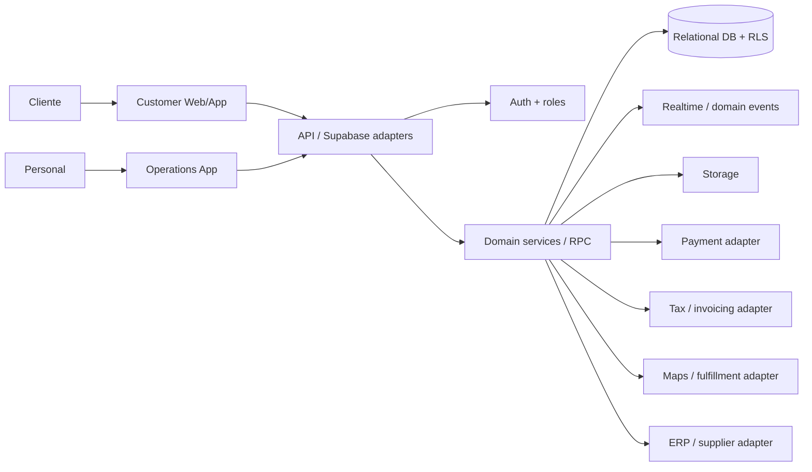

# Contexto reutilizable para sistemas web de retail

> Documento portable derivado de la arquitectura de SysBurger. Está pensado
> para copiarse a otro repositorio antes de diseñar un sistema para
> supermercado, almacén, tienda minorista u otro negocio con catálogo,
> inventario y pedidos.
>
> Este archivo es un contexto de diseño, no una especificación cerrada ni una
> instrucción para copiar el esquema SQL original.

## 1. Veredicto de reutilización

La solución de SysBurger **sí se puede abstraer**, pero como una plataforma de
retail modular, no como un sistema de supermercado terminado.

### Qué es reutilizable

- Separación entre aplicación pública para clientes y aplicación interna para
  personal.
- Backend gestionado con Auth, base relacional, RLS, Realtime, Storage y
  funciones server-side.
- Monorepo con paquete compartido para dinero, fechas, estados, validaciones y
  contratos.
- Modelo de permisos por rol reforzado en base de datos, no solo en la UI.
- Configuración por tenant, marca, módulos habilitados y licencia.
- Integración de pagos mediante funciones server-side que custodian secretos.
- Tests unitarios, integración, RLS/RPC, E2E y performance.
- Docker, migraciones versionadas, backups, rollback y despliegue de dos
  frontends.
- Uso de eventos/Realtime para reflejar cambios operativos entre cliente,
  depósito, caja y despacho.

### Qué no debe copiarse sin rediseño

- `orders` como centro universal del negocio.
- `menu_items`, recetas, cocina, repartidores y códigos de entrega de cuatro
  dígitos.
- Stock entendido únicamente como descuento por venta.
- Delivery como único fulfillment.
- Una sola unidad de medida, precio y presentación por producto.
- Un único local representado por `store_settings.id='default'`.
- Estados de pedido gastronómicos como `pendiente`, `en cocina`, `listo`,
  `entregado`.
- Mercado Pago, moneda ARS, Nominatim y reglas de restaurante como
  dependencias del core.
- Copias manuales de migraciones o `schema.sql` histórico como fuente de
  verdad.

**Regla principal:** abstraer los contratos y capacidades, no los nombres de
las tablas ni los flujos particulares de SysBurger.

## 2. Modelo mental recomendado

Construir un **modular monolith de retail con dos superficies desplegables**:

1. **Customer web/app:** catálogo, búsqueda, carrito, checkout, cuenta,
   direcciones, seguimiento, promociones y soporte.
2. **Operations app:** catálogo, inventario, compras, preparación, picking,
   caja, despacho, sucursales, usuarios y reportes.
3. **Backend:** Auth, API, base relacional, RLS, eventos, storage y funciones
   server-side.
4. **Shared package:** tipos, schemas, dinero, unidades, estados, permisos y
   reglas puras.
5. **Integraciones:** pagos, email/SMS/push, mapas, facturación, ERP/WMS,
   proveedores y logística, siempre detrás de adapters.

No introducir microservicios de entrada. Primero demostrar límites de dominio,
volumen, equipos independientes y necesidad operacional. La complejidad de un
supermercado suele estar en la consistencia del inventario y los precios, no en
la cantidad de servicios.

## 3. Capacidades que deben ser configurables

El sistema nuevo debe activar capacidades por tenant, sucursal o canal sin
mezclar autorización con simples flags visuales.

| Capacidad | Ejemplo | Pregunta que debe resolverse |
|---|---|---|
| Catálogo | alimentos, limpieza, farmacia | ¿hay variantes, marcas, atributos y sustitutos? |
| Inventario | stock por sucursal/deposito | ¿se reserva, se compromete o se descuenta al despachar? |
| Venta | online, mostrador, teléfono | ¿cada canal usa el mismo precio y stock? |
| Fulfillment | delivery, pickup, retiro en tienda | ¿quién prepara y quién entrega? |
| Productos pesables | frutas, carnes, fiambres | ¿se vende por unidad, peso, volumen o medida variable? |
| Promociones | 2x1, combos, descuentos por cantidad | ¿cómo se calcula y audita el precio final? |
| Pagos | tarjeta, efectivo, transferencia, wallet | ¿cuándo se autoriza, captura, reembolsa o concilia? |
| Fidelización | puntos, cupones, niveles | ¿qué eventos generan y revierten beneficios? |
| Compras | proveedores, órdenes de compra | ¿el inventario se repone automáticamente o manualmente? |
| Facturación | ticket, factura, impuestos | ¿qué jurisdicción, numeración y datos fiscales aplican? |
| Multi-sucursal | tiendas, depósitos, zonas | ¿qué datos son globales y cuáles locales? |
| Licenciamiento | módulos por tenant | ¿qué está contratado, habilitado y permitido? |

Un módulo habilitado nunca debe ser el único control: la operación debe estar
protegida por RLS/RPC, validación de dominio y auditoría.

## 4. Modelo de dominio portable

Estas son capacidades conceptuales. Los nombres finales, normalización y
fronteras deben decidirse para cada negocio.

### Identidad y organización

- `tenants`
- `stores` o sucursales
- `warehouses` o depósitos
- `users`
- `roles`
- `permissions`
- `staff_profiles`
- `audit_events`

Separar tenant, sucursal y depósito desde el inicio. No asumir un único local.
Definir explícitamente el alcance de cada usuario: global, tenant, sucursal,
depósito o tarea.

### Catálogo

- `products`
- `product_variants`
- `brands`
- `categories`
- `attributes`
- `product_barcodes`
- `product_media`
- `product_substitutions`
- `tax_categories`

Un producto comercial no siempre es una fila vendible. La unidad vendible puede
tener SKU, código de barras, presentación, peso, volumen, impuestos, proveedor,
costo y precio propios.

### Inventario

- `inventory_locations`
- `inventory_items`
- `inventory_balances`
- `inventory_movements`
- `inventory_reservations`
- `inventory_adjustments`
- `stock_counts`
- `lot_batches` y vencimientos, si aplican

El stock debe modelarse como un **ledger de movimientos** o como un balance
derivado de movimientos auditables. Evitar actualizar solo un número sin
registrar motivo, actor, referencia y timestamp.

Estados mínimos recomendados:

```text
available -> reserved -> committed -> picked -> fulfilled
available -> damaged / expired / lost / adjusted
reserved -> released
```

No asumir que “pedido creado” significa “stock descontado”. Elegir una política
por negocio y hacerla idempotente.

### Precios y promociones

- `price_lists`
- `product_prices`
- `price_rules`
- `promotions`
- `coupons`
- `promotion_redemptions`
- `tax_rates`

Guardar el precio aplicado y el motivo/regla que lo produjo en cada línea de
venta. Nunca recalcular retrospectivamente una venta histórica usando el precio
actual.

### Compra y fulfillment

- `carts`
- `orders`
- `order_lines`
- `order_status_history`
- `fulfillment_orders`
- `pick_tasks`
- `packing_tasks`
- `delivery_assignments`
- `pickup_windows`
- `delivery_zones`
- `substitution_decisions`

Separar `order` de `fulfillment`. Un pedido puede dividirse entre sucursales,
depósitos, ventanas o entregas. Un supermercado puede aceptar sustituciones,
faltantes parciales y ajustes de peso.

### Pago y postventa

- `payments`
- `payment_attempts`
- `refunds`
- `invoices`
- `returns`
- `complaints`
- `customer_notifications`

El pago y el estado del pedido son máquinas de estados relacionadas, pero no
la misma máquina. Un webhook repetido no puede duplicar capturas, entregas o
reembolsos.

## 5. Qué se mantiene y qué se transforma desde SysBurger

| Concepto de SysBurger | Decisión para retail |
|---|---|
| `customer-web` | Mantener como superficie pública; agregar búsqueda, filtros, SEO y disponibilidad |
| `staff-pwa` | Mantener como app operativa, pero dividir internamente por catálogo, inventario, picking, caja y despacho |
| `packages/shared` | Expandir con schemas, estados, dinero, unidades, impuestos y permisos |
| Supabase Auth/RLS/Realtime | Mantener si el volumen, compliance y latencia son adecuados |
| `orders` | Mantener como agregado comercial, separar fulfillment, pagos e inventario |
| `menu_items` | Reemplazar por catálogo/SKU/variante/presentación |
| `delivery` | Convertir en una estrategia de fulfillment junto con pickup y retiro |
| `couriers` | Convertir en actor de logística; no asumir que todo fulfillment usa repartidor |
| recetas/combos | Convertir en opcionales: bundles, kits, packs o BOM |
| `modules_enabled` y `licensed_modules` | Mantener, pero con alcance tenant/sucursal/canal y auditoría |
| Mercado Pago | Mantener como adapter de pagos, no como dependencia del dominio |
| Nominatim | Mantener como adapter geográfico intercambiable |
| `store_settings` único | Reemplazar por configuración por tenant, sucursal y canal |
| migration duplicada | Eliminar: una única fuente canónica con artefactos generados |
| Guest checkout | Mantener solo si el negocio acepta sus riesgos y se agrega antifraude |

## 6. Diferencias críticas de un supermercado

### 6.1 Catálogo e inventario

El supermercado tiene más variantes, SKU y proveedores que un restaurante. El
modelo debe soportar:

- códigos de barras múltiples;
- productos por peso;
- unidades de compra y venta diferentes;
- lotes, vencimientos y trazabilidad;
- stock por tienda, depósito y zona de picking;
- inventario reservado para pedidos online;
- productos agotados y sustituciones;
- costos, márgenes y precio histórico;
- inventario negativo controlado, si el negocio lo permite.

### 6.2 Precio y promociones

Las promociones pueden depender de cliente, horario, sucursal, cantidad,
medio de pago, membresía, combo o producto sustituto. El cálculo debe ser
server-side, explicable y reproducible.

### 6.3 Fulfillment

Un pedido puede ser:

- delivery a domicilio;
- pickup en una sucursal;
- retiro en locker o mostrador;
- preparado en una o varias sucursales;
- parcial por falta de stock;
- sustituido con aprobación automática o del cliente.

Por eso no se debe reutilizar una máquina de estados de cocina sin separar
pedido, preparación, entrega y pago.

### 6.4 Fiscalidad y compliance

El supermercado puede exigir facturación electrónica, impuestos variables,
datos fiscales, límites de venta, trazabilidad de alimentos, privacidad,
retención de datos y auditoría. Estas necesidades son decisiones de negocio y
jurisdicción, no deben inferirse del sistema gastronómico.

## 7. Arquitectura lógica objetivo



El frontend no debe construir reglas de precio, autorización, inventario o
impuestos por su cuenta. Puede previsualizar, pero el backend debe recalcular y
validar.

## 8. Contratos que deben definirse antes de programar

Para cada nuevo sistema, completar estas decisiones:

### Tenant y alcance

- ¿Es single-store, multi-store o multi-tenant?
- ¿Qué configuración hereda una sucursal?
- ¿Puede un usuario operar varias sucursales?
- ¿Qué datos son globales, locales o por canal?

### Producto

- ¿Qué es el SKU?
- ¿Se vende por unidad, peso, volumen o fracción?
- ¿Qué identifica la línea: producto, variante, lote o barcode?
- ¿Qué pasa si el producto cambia de precio durante el checkout?

### Inventario

- ¿Cuándo se reserva?
- ¿Cuándo se descuenta?
- ¿Qué ocurre si falta stock al pickear?
- ¿Se permiten sustituciones?
- ¿Cómo se audita un ajuste manual?

### Pedido

- ¿Qué estados son válidos?
- ¿Se permiten cambios después del pago?
- ¿Puede dividirse?
- ¿Cómo se calculan costos de envío, impuestos y descuentos?

### Pago

- ¿Hay autorización y captura separadas?
- ¿Cómo se manejan expiración, rechazo, reintento y refund?
- ¿Qué webhook es fuente de verdad?
- ¿Cómo se evita replay/idempotencia defectuosa?

### Seguridad

- ¿Qué ve cada actor por tenant, sucursal, depósito y pedido?
- ¿Qué operaciones requieren aprobación?
- ¿Qué datos personales se almacenan y por cuánto tiempo?
- ¿Qué eventos deben quedar en auditoría inmutable?

## 9. Reglas técnicas para el nuevo proyecto

1. Usar migraciones timestamped como única fuente de verdad.
2. Generar o verificar cualquier schema de bootstrap; no mantener copias SQL
   editadas a mano.
3. Definir schemas de entrada/salida para API, RPC y Edge Functions.
4. Implementar RLS/RPC antes de las pantallas administrativas.
5. Separar adapters externos de reglas de dominio.
6. Usar idempotency keys para crear pedidos, pagos, webhooks y movimientos.
7. Registrar historial de estados y movimientos, no solo el estado actual.
8. No poner secretos en variables públicas `VITE_*` ni en bundles.
9. Diseñar integración offline solo para operaciones explícitamente elegidas;
   no asumir que localStorage es una base confiable de inventario.
10. Probar concurrencia en stock, promociones, claims y webhooks.
11. Ejecutar integración con datos aislados; no depender de una base compartida
    contaminable.
12. Mantener el frontend público indexable y la app interna protegida/noindex.
13. Medir accesibilidad, Core Web Vitals, errores de pago y latencia de
    inventario.
14. Mantener auditoría de actor, tenant, sucursal, motivo, antes/después y
    correlación, evitando PII innecesaria.
15. No dividir en microservicios hasta probar que una frontera de dominio puede
    desplegarse, observarse y recuperarse de forma independiente.

## 10. Estrategia de pruebas reutilizable

### Unitarias

- dinero, redondeo e impuestos;
- unidades y conversiones;
- promociones;
- estados y transiciones;
- permisos;
- disponibilidad y sustituciones;
- validación de payloads.

### Integración

- RLS por actor, tenant, sucursal y depósito;
- reserva/liberación/compromiso de stock;
- creación idempotente de pedido;
- concurrencia de dos pickers;
- precio aplicado y promoción;
- refund y webhook repetido;
- devolución y ajuste de inventario;
- límites de guest checkout.

### E2E

- cliente busca, agrega, compra y recibe confirmación;
- operador prepara y resuelve faltantes;
- cliente aprueba/rechaza sustitución;
- pickup y delivery;
- pago rechazado, reintento y devolución;
- usuario sin permiso no puede acceder a otra sucursal;
- app interna no se indexa.

### Performance

- búsqueda y filtrado de catálogo;
- lectura de disponibilidad por sucursal;
- picos de checkout;
- contención por stock;
- eventos Realtime;
- generación de picking;
- procesamiento de webhooks.

## 11. Fases sugeridas para abstraer el producto

### Fase A — Núcleo portable

Definir tenant, organización, actor, catálogo, precio, inventario, pedido,
fulfillment y pago. No copiar tablas gastronómicas. Crear contratos y matriz de
permisos.

### Fase B — Catálogo e inventario

Implementar SKU, variantes, unidades, stock por ubicación, movimientos,
reservas y ajustes. Validar concurrencia antes de construir promociones
complejas.

### Fase C — Checkout y fulfillment

Agregar delivery, pickup, retiro y preparación como estrategias configurables.
Separar el agregado comercial de sus fulfillments.

### Fase D — Promociones, pagos y fiscalidad

Agregar reglas server-side, auditoría de precio, adapters de pago y
facturación según jurisdicción.

### Fase E — Operación y ecosistema

Agregar picking, proveedores, reposición, reportes, ERP, loyalty, observabilidad
y optimización de performance.

## 12. Checklist de decisión: ¿qué copiar, qué cambiar?

Antes de comenzar otro sistema, responder:

- [ ] ¿El nuevo negocio vende servicios, unidades, peso o combinaciones?
- [ ] ¿El stock es simple o por lote/vencimiento/ubicación?
- [ ] ¿El precio es fijo o depende de reglas/promociones?
- [ ] ¿El pedido tiene uno o varios fulfillments?
- [ ] ¿Hay pickup, delivery, retiro y/o POS?
- [ ] ¿Hay más de una tienda o depósito?
- [ ] ¿Se requieren sustituciones o entregas parciales?
- [ ] ¿El pago puede quedar pendiente, autorizado, capturado o reembolsado?
- [ ] ¿Qué obligaciones fiscales y de privacidad existen?
- [ ] ¿Qué actores y alcances de RLS se necesitan?
- [ ] ¿Qué integraciones deben ser adapters intercambiables?
- [ ] ¿Qué datos requieren auditoría y retención?
- [ ] ¿Qué partes deben funcionar offline?
- [ ] ¿Qué métricas y SLOs definen una operación sana?
- [ ] ¿Cuál es la fuente única de migraciones y cómo se verifica el drift?

## 13. Prompt de contexto para usar en otro repositorio

Copiar este bloque como contexto inicial para el nuevo sistema y completarlo
antes de pedir implementación:

```text
Estamos construyendo un sistema web modular de retail para:
- Tipo de negocio: [supermercado / tienda / farmacia / otro]
- País y reglas fiscales: [completar]
- Cantidad de tenants: [completar]
- Cantidad de sucursales y depósitos: [completar]
- Canales: [web / app / POS / teléfono / marketplace]
- Fulfillment: [delivery / pickup / retiro / preparación interna]
- Productos por unidad/peso/volumen: [completar]
- Inventario por lote/vencimiento: [sí/no]
- Sustituciones y faltantes: [regla]
- Pagos: [métodos, autorización, captura, refund]
- Facturación: [requisitos]
- Integraciones: [ERP, proveedores, mapas, email, logística]
- SLO y volumen esperado: [completar]

Usar esta arquitectura base:
1. Customer web/app y Operations app como dos superficies desplegables.
2. Backend relacional con Auth, RLS, funciones server-side, eventos y storage.
3. Paquete compartido para tipos, schemas, dinero, unidades, estados y permisos.
4. Modular monolith primero; no extraer microservicios sin evidencia.
5. Adapters para pagos, impuestos, mapas, ERP y notificaciones.
6. Una única fuente canónica de migraciones; no editar copias manuales.
7. Reglas de precio, inventario, permisos e impuestos validadas server-side.
8. Idempotencia y auditoría en pedidos, pagos, webhooks y movimientos de stock.
9. Separar order, payment, inventory y fulfillment; no usar una sola máquina de
   estados para todo.
10. Diseñar RLS por tenant, sucursal, depósito, usuario y rol.

No asumir:
- que todos los productos son platos;
- que el stock se descuenta al crear el pedido;
- que existe una sola sucursal;
- que hay un repartidor para cada entrega;
- que hay una sola unidad o precio;
- que Mercado Pago, ARS, Nominatim o un proveedor específico son parte del core;
- que el schema original de otro proyecto es seguro o portable.

Antes de escribir código, producir:
- mapa de dominios y actores;
- modelo de datos conceptual;
- máquinas de estados de pedido, pago, inventario y fulfillment;
- matriz RLS/permisos;
- contratos de API/RPC/Eventos;
- estrategia de migraciones, rollback e idempotencia;
- plan de pruebas unitarias, integración, E2E y concurrencia;
- riesgos de fiscalidad, privacidad, SEO, accesibilidad y operación.

No modificar código hasta que las decisiones de negocio anteriores estén
resueltas o explícitamente marcadas como supuestos.
```

## 14. Conclusión

SysBurger es una buena base de **patrones de plataforma** para un supermercado,
pero no una base de **modelo de negocio** para copiar literalmente. La
abstracción correcta conserva la separación de superficies, Auth/RLS,
Realtime, funciones server-side, testing y operación; reemplaza el núcleo
gastronómico por catálogo, SKU, inventario por ubicación, precios, promociones,
fulfillment y fiscalidad. El mayor cambio no es visual: es separar las
máquinas de estados de pedido, pago, inventario y preparación, y diseñarlas
para concurrencia, multi-sucursal y productos variables.
